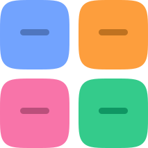

# Deskmates

A Mac app where you hire a small team of AI employees. Each one has a name, a face, a voice, a role and **its own desktop**. You message them like colleagues, watch them work, approve the big steps, and call them on video.

Built at the Imperial AI Hack (14 to 15 November 2026). Main track: Autonomous Agents. Sub-tracks: Figma, Databricks, Synthesia.

## What it does

- **Hire.** Pick a role, meet a candidate, hire. Their desktop starts in seconds and they say hello by themselves.
- **Delegate.** Give a task in plain words. They plan it, work on their own Linux desktop (browser, files, terminal) and report when it is done. You can steer mid-task.
- **Watch.** A live view of each desktop beside the conversation. Take control with your own mouse and keyboard when you want to.
- **Stay in charge.** Three permission levels per person. Big steps (publishing, sending, deleting) arrive as an approval you answer in the chat.
- **Call.** One-to-one video call: a moving, speaking face and their live desktop. **Summon meeting** brings several into one room; they take turns and answer by name.
- **Teamwork.** Employees message each other when the other's role is the right one for the job.
- **Team report.** Hours, tasks and cost per person, kept in Databricks, with a plain-language question box.
- **In the background.** Lives in the menu bar and notifies you when someone needs you.

## How it is built

```
Electron shell ── window, menu bar, notifications
      │
Renderer ── React 19 + Astryx (every screen), talks only to the office over HTTP and WebSocket
      │
Office ── local Node service (Fastify, SQLite): all state, one supervisor per employee
      ├── Employee brain ── Claude Agent SDK, one long-lived session per employee
      │       └── tools bound to that employee's own desktop only
      ├── Desktops ── Cua Spaces (one Linux desktop each), Cua Driver tools, live H.264 stream
      ├── Calls ── LiveKit room + Python voice worker; faces by Synthesia Interactive Avatars
      └── Records ── Databricks: Delta tables (timesheet and audit), Genie questions, MLflow traces
```

| Part | Technology |
| --- | --- |
| Agent harness | [Claude Agent SDK](https://docs.claude.com/en/api/agent-sdk/overview), Sonnet 5.5 by default |
| Desktops | [Cua](https://github.com/trycua/cua): one Space per employee, Cua Driver for mouse, keyboard and screen |
| Front end | [Astryx](https://github.com/meta/astryx) (`@astryxdesign/core`), neutral theme, no other UI library |
| Faces and voices | Synthesia Interactive Avatars over LiveKit, LiveKit Inference for speech |
| Records | Databricks SQL warehouse (Delta), Genie, MLflow tracing |

Each employee's tools reach only its own desktop: the host machine is never exposed to an agent unless you lend your screen on purpose.

## Run it

Needs macOS on Apple silicon, Node 24 or newer, [uv](https://docs.astral.sh/uv/) (for the voice worker, which the app starts by itself) and about 2 GB of free memory per employee desktop.

```bash
npm install && node node_modules/electron/install.js
```

```bash
cp .env.example .env.local
```

Fill in `.env.local` (Anthropic for the employees; LiveKit and Synthesia for calls; Databricks for the team report). Then:

```bash
npm run build && npm start
```

No keys? The whole app also runs with scripted employees and recorded desktops:

```bash
DESKTOPS=mock MOCK_LLM=1 npm run office:once
```

```bash
npm run web
```

and open `http://127.0.0.1:4318`.

## Check it

```bash
npm run check
```

runs the type checks, the unit tests and the Astryx purity check. `npx tsx scripts/e2e/mock.ts` drives the whole app with scripted employees; `npx tsx scripts/e2e/real.ts` does the same with real models on real desktops (costs a few cents on Haiku).

## Where things are

- `src/office` the local service: employees, desktops, calls, records
- `src/renderer` the Astryx front end
- `src/main`, `src/preload` the Mac shell
- `voice` the Python voice worker for calls
- `config` the cast (names, faces, voices) and role presets
- `docs/hackathon` the full record of the build: brief, decisions, research, specs, design notes and build log

Third-party code: the desktop stream viewer in `src/renderer/src/media/cua-viewer` is adapted from Cua (FSL-1.1-MIT).
